# Introduction to Computer

## Definition of a Computer

A **computer** is an electronic machine designed to perform calculations and control operations that can be expressed in **numerical or logical terms**. 

In simple terms, a computer is an electronic device that can **receive data, process it according to instructions, store information, and produce useful results**.

## Applications of Computers

The application of computers is largely determined by **human creativity and imagination**. Computers are used across a wide range of fields, including:

* **Education** — teaching, learning, research, and online education.
* **Industry** — production, automation, monitoring, and management.
* **Government** — record keeping, administration, and public services.
* **Medicine** — medical research, diagnosis, patient records, and healthcare management.
* **Scientific research** — calculations, simulations, data analysis, and experimentation.
* **Music and arts** — music production, graphic design, animation, and digital creativity.

Computers are particularly valuable because they can perform **millions of complex calculations in a very short time** and can support difficult decision-making accurately and at relatively low cost. 

---

## Characteristics of Computers

Computers possess several characteristics that distinguish them from many other machines.

### 1. Speed

A computer can process data at an extremely high speed. It can execute millions of instructions within seconds and perform tasks that could take a human being days or even years.

> **Key idea:** Computers are capable of processing large amounts of data at very high speeds.

The computing speed are measured in **MHz**. 

---

### 2. Accuracy

Computers can perform operations with a high degree of accuracy. However, the accuracy of the result depends on the **instructions provided and the type of computer system being used**. 

This leads to an important principle:

> **A computer generally produces results according to the instructions and data it receives.**

---

### 3. Diligence

A computer does not experience human limitations such as **tiredness, boredom, or loss of concentration**.

It can repeatedly perform the same operation for long periods without becoming fatigued. 

**Example:**
A computer can process thousands of records using the same instructions without becoming tired.

---

### 4. Reliability

**Reliability** refers to the ability of a computer to perform according to a predetermined standard without failure.

In other words, a reliable computer system can consistently perform its intended operations correctly. 

---

### 5. Storage Capability

Computers can store large amounts of data and information for future use.

The main memory of a computer has limited capacity, so information can also be stored on **secondary storage devices**, such as magnetic disks and tapes. 

**Examples of information that can be stored include:**

* Documents
* Images
* Programs
* Databases
* Audio and video files

---

### 6. Versatility

**Versatility** is the ability of a computer to perform different types of tasks.

For example, a computer can be used to:

1. Type a letter.
2. Play music.
3. Print a document.
4. Perform calculations.
5. Process data.

These different tasks can be performed by changing the program or instructions given to the computer. 

> **Key idea:** One computer can perform many different functions depending on the software and instructions being used.

---

### 7. Resource Sharing

Computers make it possible to share expensive resources among multiple users or computers.

For example, several computers can share:

* Printers
* Data
* Information
* Storage resources
* Other network resources

Connecting computers allows users to share data and information, thereby creating a larger information and knowledge base. 

---

## Quick Summary: Characteristics of Computers

| Characteristic       | Meaning                                                            |
| -------------------- | ------------------------------------------------------------------ |
| **Speed**            | Performs operations very quickly                                   |
| **Accuracy**         | Produces accurate results when given correct instructions and data |
| **Diligence**        | Does not become tired or lose concentration                        |
| **Reliability**      | Performs consistently according to predetermined requirements      |
| **Storage**          | Stores data and information for future use                         |
| **Versatility**      | Performs many different types of tasks                             |
| **Resource sharing** | Allows hardware, data, and information to be shared                |

---

## Evolution of Computers

The **evolution of computers** describes the gradual development of computing devices from simple manual counting tools to sophisticated electronic computers.

The development of computers did not happen at once. It occurred through a series of inventions and technological improvements.

## 1. Early Counting Methods

In the earliest period, people used simple methods for counting and performing basic calculations.

They used:

* **Fingers**
* **Pebbles**
* Lines drawn in sand

These methods were useful for simple counting but became inadequate as calculations became more complex. 

---

## 2. The Abacus

To make counting and calculation easier, people in **Asia Minor** developed the **abacus**.

The abacus was a counting device consisting of **sliding beads arranged on a rack**. It allowed users to perform calculations more systematically. 

### Importance of the Abacus

The abacus represents an important early stage in the development of computing because it provided a structured method for performing calculations.

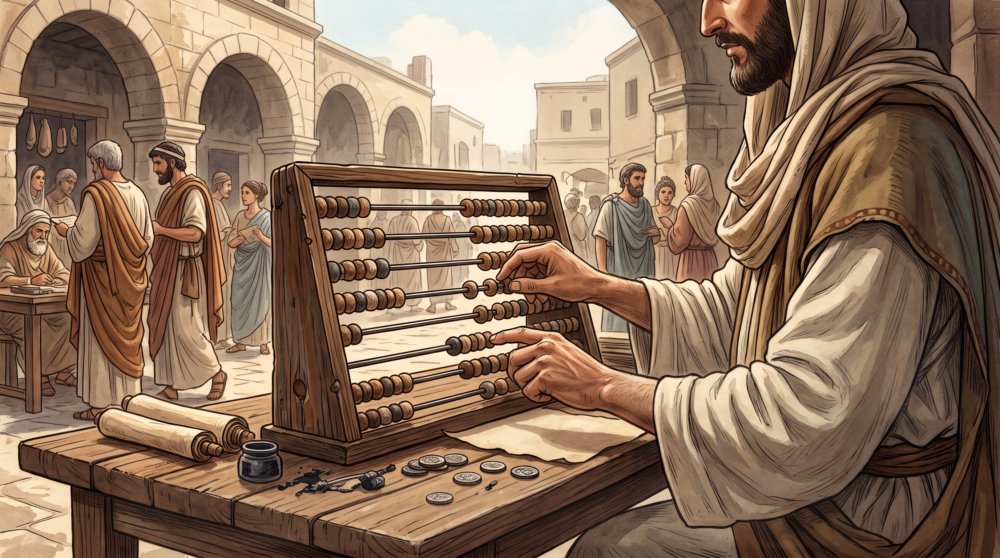
---

## 3. Napier's Bones and the Slide Rule

As the need for more advanced calculations increased, other calculating devices were developed, including:

* **Napier's Bones**
* **Slide Rule**

These devices improved the ability to perform mathematical calculations compared with simple manual counting methods. 

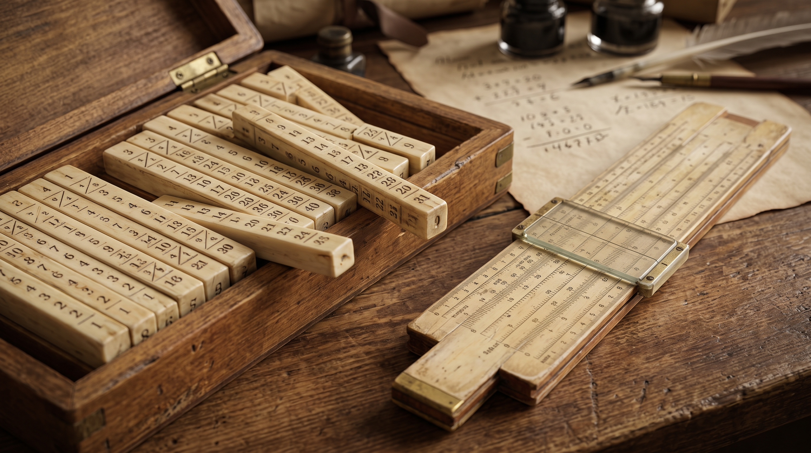
---

## 4. Pascaline — 1642

In **1642**, French mathematician **Blaise Pascal** invented the **Pascaline**, described in the course material as the first functional automatic calculator.

It was a brass rectangular mechanical calculator that used movable components to perform addition. 

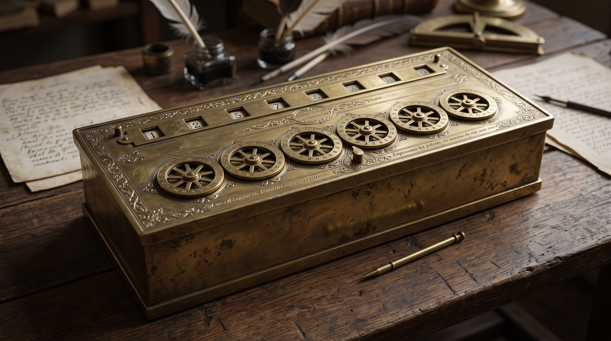
---

## 5. Stepped Reckoner — 1694

In **1694**, German mathematician **Gottfried Wilhelm von Leibniz** extended Pascal's design.

His machine, known as the **Stepped Reckoner**, could perform:

* Addition
* Multiplication
* Division
* Square-root calculations

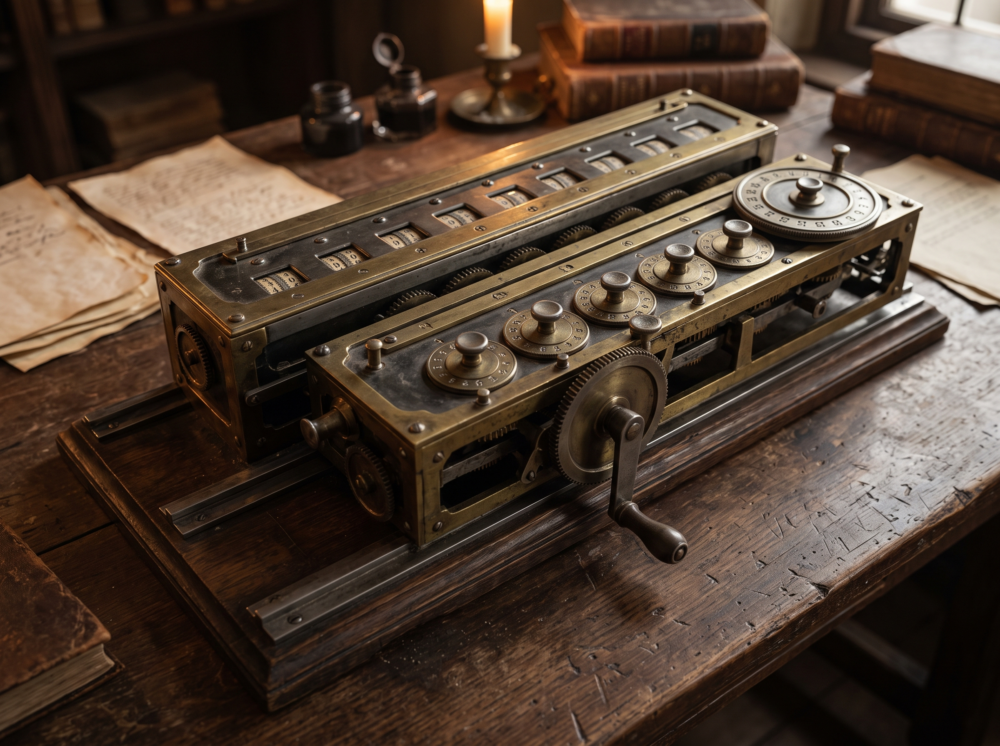

---

## 6. Charles Babbage and the Difference Engine — 1822

The development of computers took a significant step forward with the work of **Charles Babbage**, an English mathematics professor.

In **1822**, Babbage proposed a machine called the **Difference Engine**, designed to perform calculations involving differential equations. 

Babbage is therefore an important figure in the history of computing.

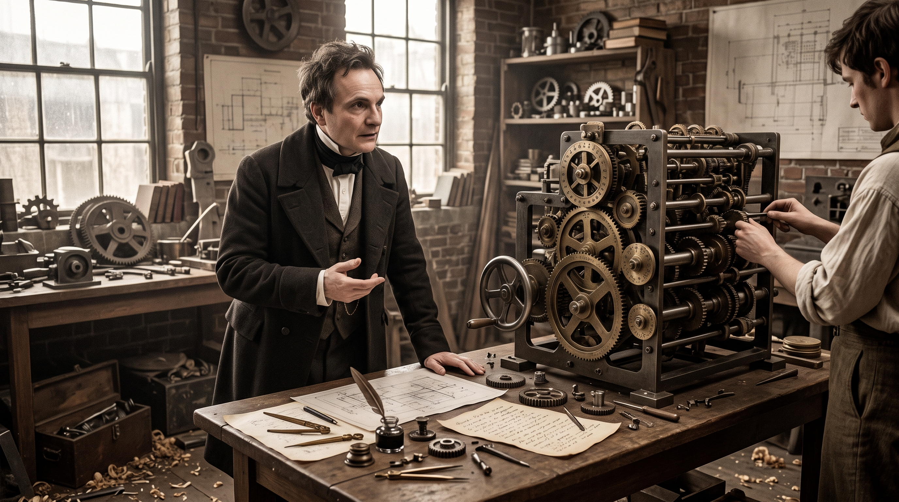
---

## 7. Herman Hollerith — 1889

In **1889**, **Herman Hollerith**, who worked for the U.S. Census Bureau, applied the concept of the **Jacquard loom** to computing.

His method used **cards to store data**, which were fed into a machine that mechanically compiled the results. 

This represented an important development in the automated processing of large quantities of information.

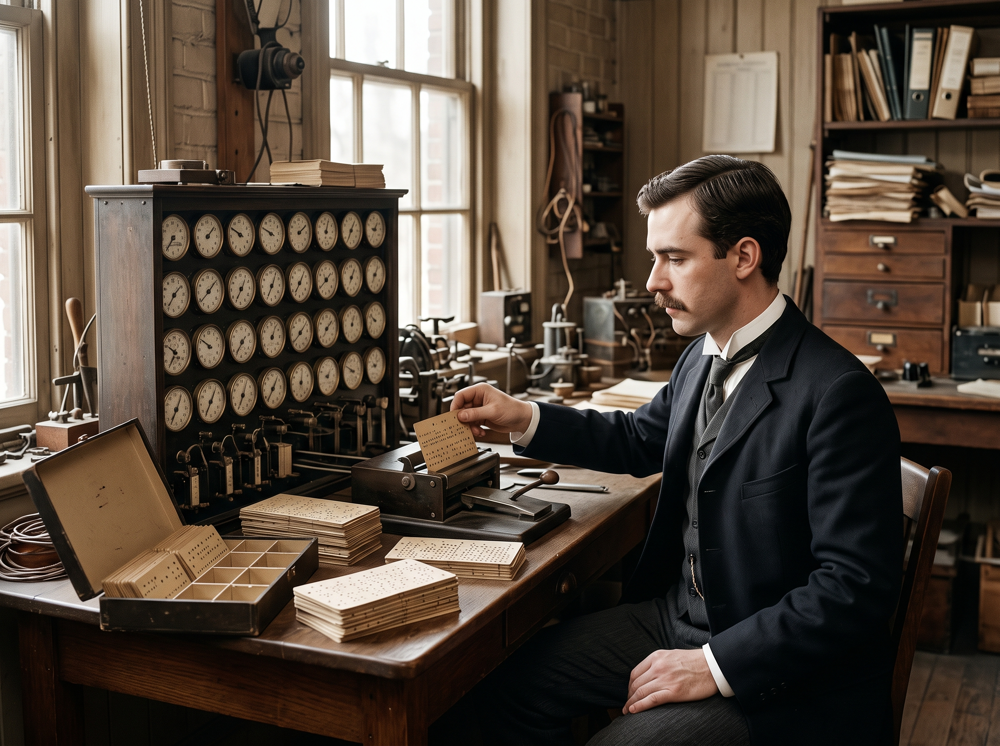
---

## 8. Harvard Mark I — 1944

In **1944**, the **Mark I** was built through a partnership between **Harvard Aiken and IBM**.

The machine used **relays and electromagnetic components** to replace mechanical components. 

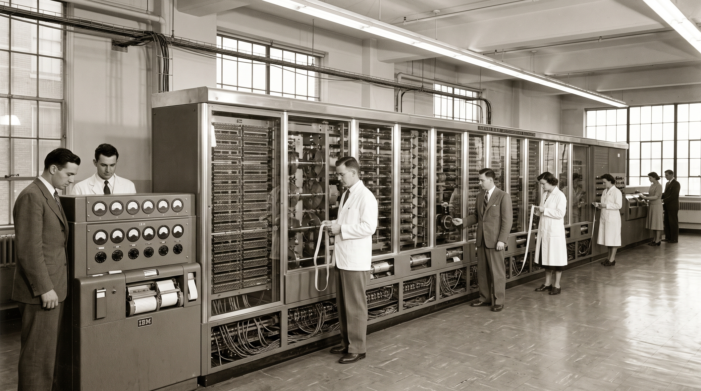
---

## 9. ENIAC — 1946

In **1946**, **John Eckert and John Mauchly** developed **ENIAC**, which stands for:

> **Electronic Numerical Integrator and Computer**

ENIAC used **electronic vacuum tubes** in its internal components. 

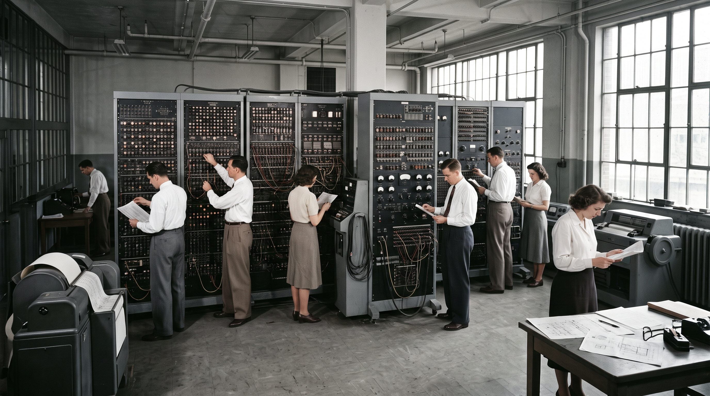
---

## 10. EDVAC

Eckert and Mauchly also proposed the development of **EDVAC**:

> **Electronic Discrete Variable Automatic Computer**

EDVAC was the first electronic computer in the course material to use the **stored-program concept**, associated with **John von Neumann**. 

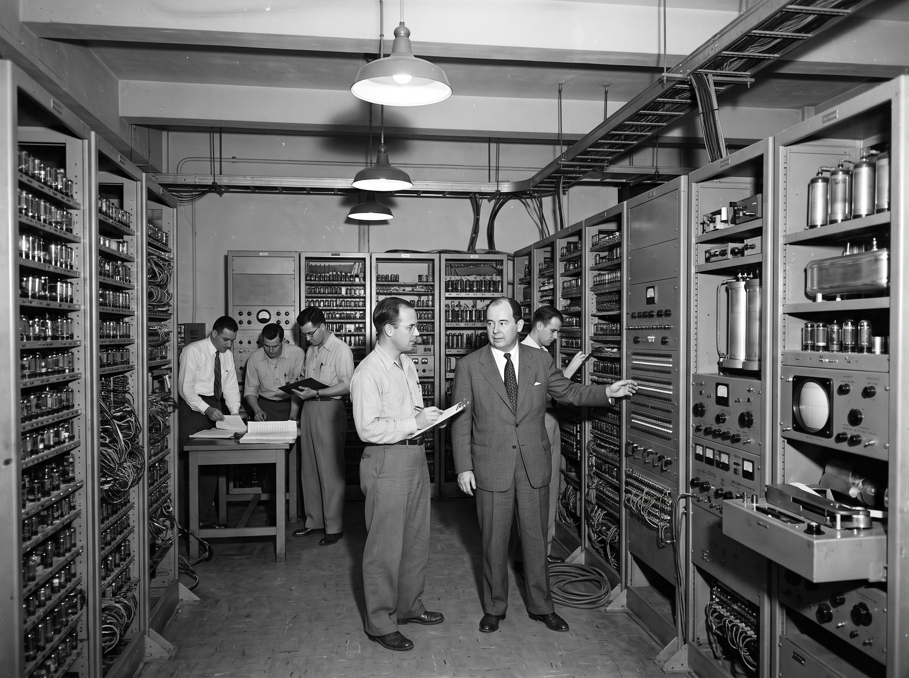

### Why was the stored-program concept important?

Instead of treating instructions as something completely separate from stored data, the stored-program concept allowed instructions to be stored in the computer's memory for execution.

---

## 11. EDSAC — 1949

In **1949**, at Cambridge University, **Maurice Wilkes** developed **EDSAC**, meaning:

> **Electronic Delay Storage Automatic Calculator**

The machine used **mercury delay lines for memory** and **vacuum tubes for logic**. 

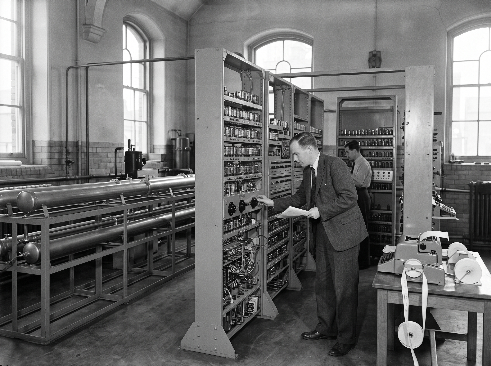
---

## 12. UNIVAC — 1951

In **1951**, the **Eckert–Mauchly Corporation** manufactured **UNIVAC**, meaning:

> **Universal Automatic Computer**

Its implementation marked the **real beginning of the computer era**. 

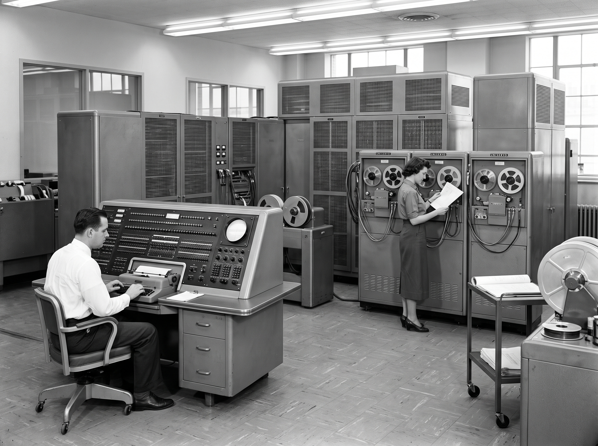
---
### First NASA Astronaut in Orbit (1962): watched 2016 Hidden Figures movie ?
- Astronaut John Glenn became the first American to fully orbit the Earth on February 20, 1962.

In the movie Hidden Figures, the computing room scenes center on Dorothy Vaughan and her team of African-American female mathematicians (known as "human computers") working in the segregated West Area Computing unit at NASA’s Langley Research Center.

**Key Events in the Computing Room & IBM Transition**

- Segregated Work Area: Dorothy and her co-workers perform complex mathematical calculations by hand using mechanical calculators in a separate, racially segregated office away from white employees.

- The Arrival of the IBM 7090: NASA purchases and installs a massive, room-filling IBM 7090 electronic computer meant to automate calculations and threaten the jobs of the human computers.

- Self-Taught FORTRAN: Realizing that the electronic machine will render her department obsolete unless someone knows how to run it, Dorothy sneaks a book on FORTRAN (an early computer programming language) from a whites-only public library section.

- Mastering the Machine: Dorothy teaches herself FORTRAN, trains all the women in the West Area computing group, and sneaks into the computer room to successfully turn on and operate the IBM mainframe when engineers struggle to get it working.

- Historic Promotion: Impressed by her initiative and the readiness of her team, NASA officially promotes Dorothy to supervisor of the Programming Department, and she negotiates the transfer of her entire team of West Area women to work alongside her on the new system.

# COMPUTER GENERATIONS

The development of computers can be divided into different **generations**, based mainly on the major technologies used in their design and operation.

The five generations discussed in this section are:

1. **First Generation – Vacuum Tubes**
2. **Second Generation – Transistors**
3. **Third Generation – Integrated Circuits**
4. **Fourth Generation – Microprocessors**
5. **Fifth Generation – Artificial Intelligence**

---

## A. First Generation (1940–1956): Vacuum Tubes

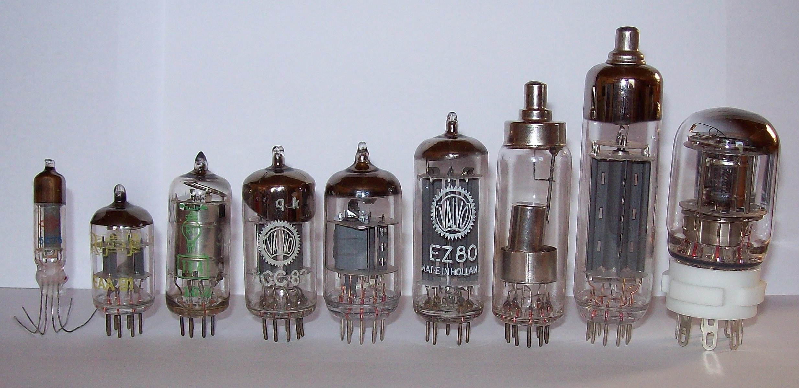

The **first generation computers** were based on **vacuum tubes (thermionic valves)**. They used:

* **Vacuum tubes** for circuitry.
* **Magnetic drums** for memory.
* **Punched cards and paper tape** for input.
* **Printouts** for output.

A **magnetic drum** is a metal cylinder coated with magnetic iron-oxide material on which data and programs can be stored.

### Examples

* **ENIAC**
* **EDVAC**
* **UNIVAC**

### Characteristics of First Generation Computers

* They were based on **vacuum tube technology**.
* They were the **fastest computing devices of their time**.
* They were **very large** and required a lot of space for installation.
* They were **non-portable** and very slow equipment.

---

## B. Second Generation (1956–1963): Transistors

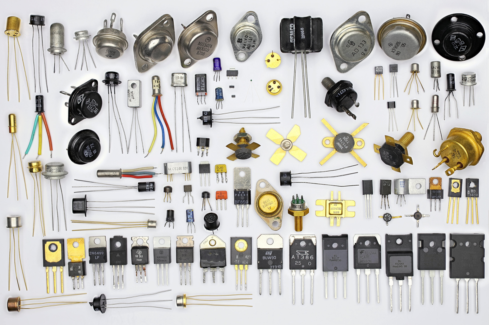

The second generation of computers was based on **transistors**.

A **transistor** is made from semiconductor materials such as **germanium and silicon**. It usually has three leads and performs electrical functions such as **voltage, current, or power amplification** with low power requirements.

Because a transistor is a small device, the physical size of computers was greatly reduced.

Computers of this generation became:

* Smaller
* Faster
* Cheaper
* More energy-efficient
* More reliable

### Memory and Storage

* **Magnetic cores** were used as primary memory.
* **Magnetic disks** were used as secondary storage devices.
* They still relied on **punched cards for input**.
* **Printouts** were used for output.

### Examples

* **PDP-8**
* **IBM 1401**
* **IBM 7090**

### Characteristics of Second Generation Computers

* They were based on **transistor technology**.
* They were **smaller** compared with first-generation computers.
* They were **more portable**.
* They generated **less heat**.

---

## C. Third Generation (1964–Early 1970): Integrated Circuits

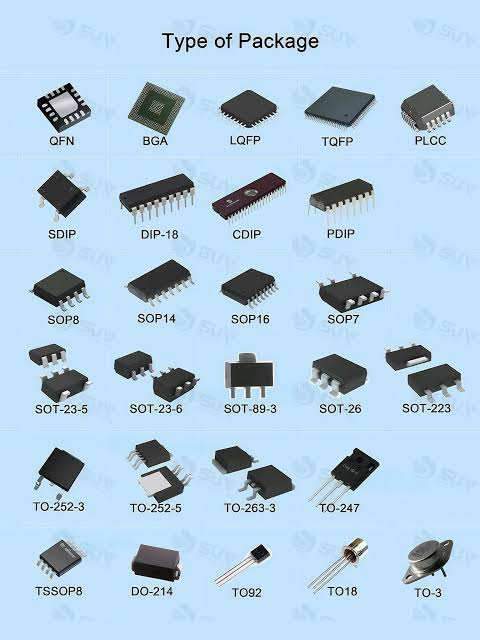

The major development of the third generation was the **integrated circuit (IC)**.

An **integrated circuit**, also called an **IC**, consists of a single chip containing many components, such as **transistors and resistors**, fabricated on it.

The integrated circuit replaced several individually wired transistors. This development made computers:

* Smaller in size
* More reliable
* More efficient

### User Interaction

Instead of relying mainly on punched cards and printouts, users interacted with third-generation computers through:

* **Keyboards**
* **Monitors**
* **Operating systems**

### Examples

* **NCR 395**
* **B6500**

### Characteristics of Third Generation Computers

* They were based on **integrated circuit (IC) technology**.
* They reduced computational time from **microseconds to nanoseconds**.
* Extensive use of **high-level languages** became possible.

---

## D. Fourth Generation (Early 1970–Till Date): Microprocessors

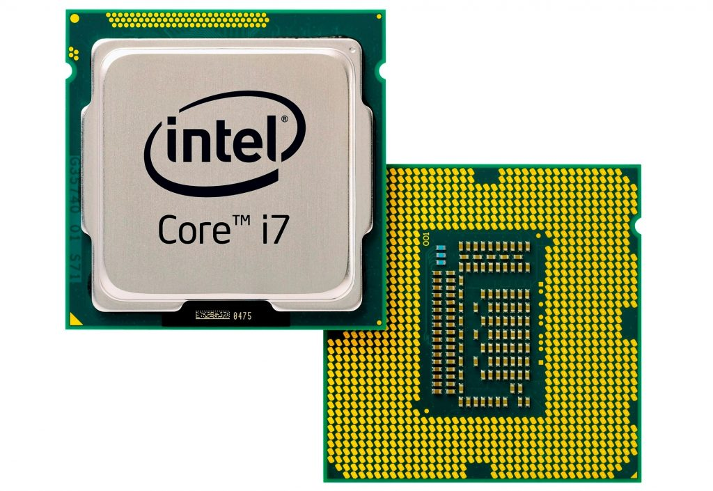

The fourth generation was still based on **integrated-circuit technology**, but the development of the **microprocessor** made this technology readily available for use.

The fourth generation led to the development of:

* **LSI – Large Scale Integration**
* **VLSI – Very Large Scale Integration**
* **ULSI – Ultra-Large Scale Integration**

### LSI

**LSI technology** allowed thousands of transistors to be constructed on a small slice of silicon material.

### VLSI

**VLSI technology** allowed hundreds of thousands of components to be placed onto a single chip.

### ULSI

**ULSI technology** increased the number of components into the millions.

As a result, fourth-generation computers became:

* More powerful
* More compact
* More reliable
* More affordable

### Examples

* **Apple II**
* **Altair 8800**
* **CRAY-1**

### Characteristics of Fourth Generation Computers

* They are **microprocessor-based systems**.
* They are **very small**.
* **GUI and pointing devices** enable users to learn to use computers quickly.
* Interconnection of computers leads to better **communication and resource sharing**.

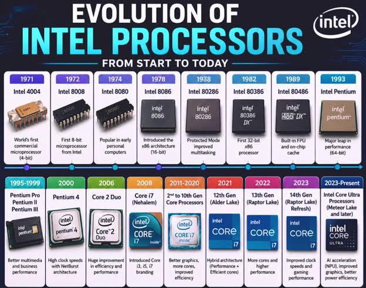
---

## E. Fifth Generation (Present and Beyond): Artificial Intelligence

The fifth generation represents the development of computers toward **Artificial Intelligence (AI)**.

### 1. Artificial Intelligence Hardware Accelerators

AI hardware accelerators are specialized processors designed to execute the heavy matrix math and parallel computations required for machine learning much faster and more energy-efficiently than standard CPUs.

* **GPU**
- [Nvidia Graphics Cards](https://www.nvidia.com/en-us/geforce/graphics-cards/)
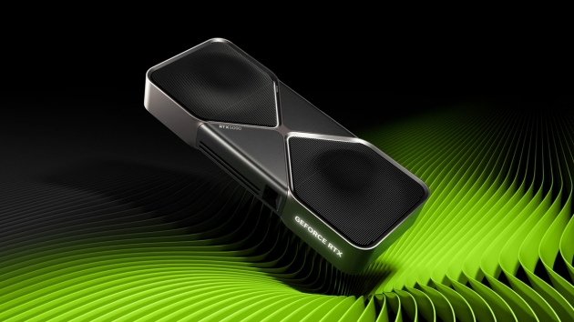
* **TPU**
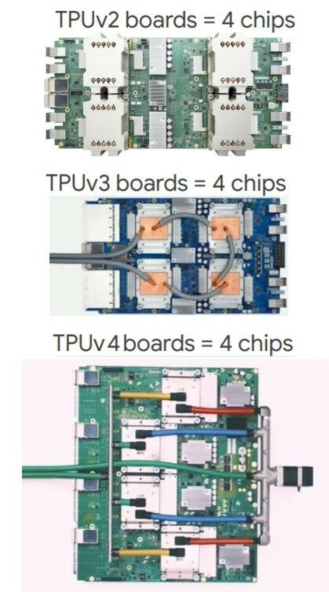
- [Google Tensor Processing Units](https://cloud.google.com/tpu)
* **NPU**
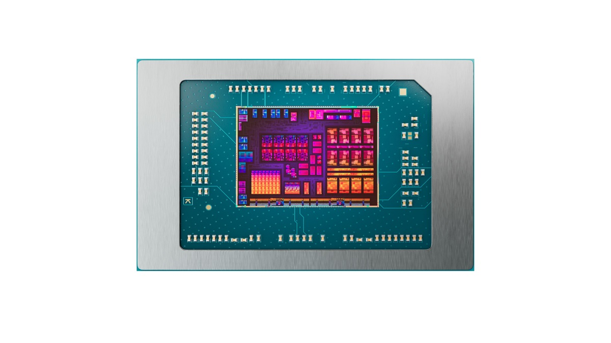
- [FuriosaAI NPU](https://furiosa.ai/architecture)

### 2. Mega Chips (System on a Chip)
A System on a Chip (SoC) is defined as an integrated circuit that combines multiple cores, such as CPUs, GPUs, and other functional units, along with memory, input/output ports, and sometimes modems on a single substrate. 

* SoCs are miniaturized IC devices that integrate all the essential components of a computer or electronic system onto a single microchip. Imagine having a central processing unit (CPU), memory, input/output (I/O) interfaces, and even specialized processors like graphics processing units (GPUs) all condensed onto a tiny silicon chip. 

* SoCs are ubiquitous in modern electronics, powering everything from smartphones and laptops to wearables and smart home devices.

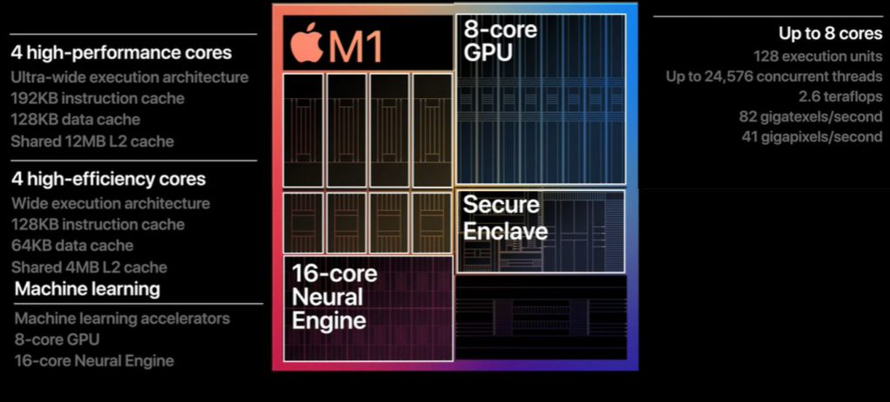

- [Apple unleashes M5, the next big leap in AI performance for Apple silicon](https://www.apple.com/newsroom/2025/10/apple-unleashes-m5-the-next-big-leap-in-ai-performance-for-apple-silicon/)

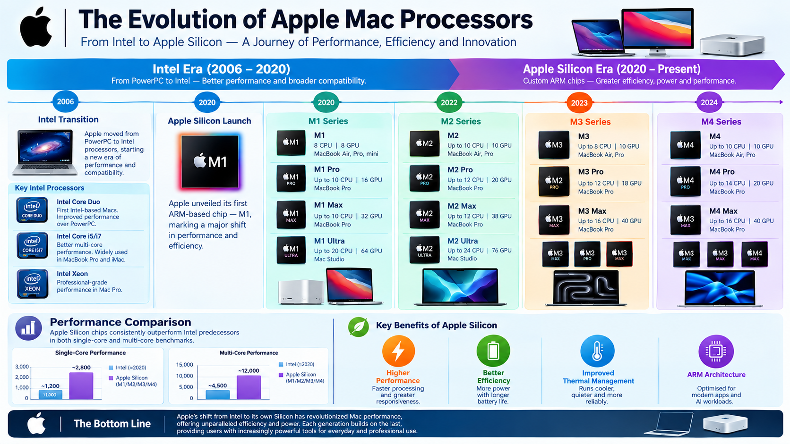

### 3. Parallel Processing and Distributed Training

**Parallel processing and distributed training** splits AI heavy workloads across multiple GPUs, CPU cores, or networked machines to speed up training process.

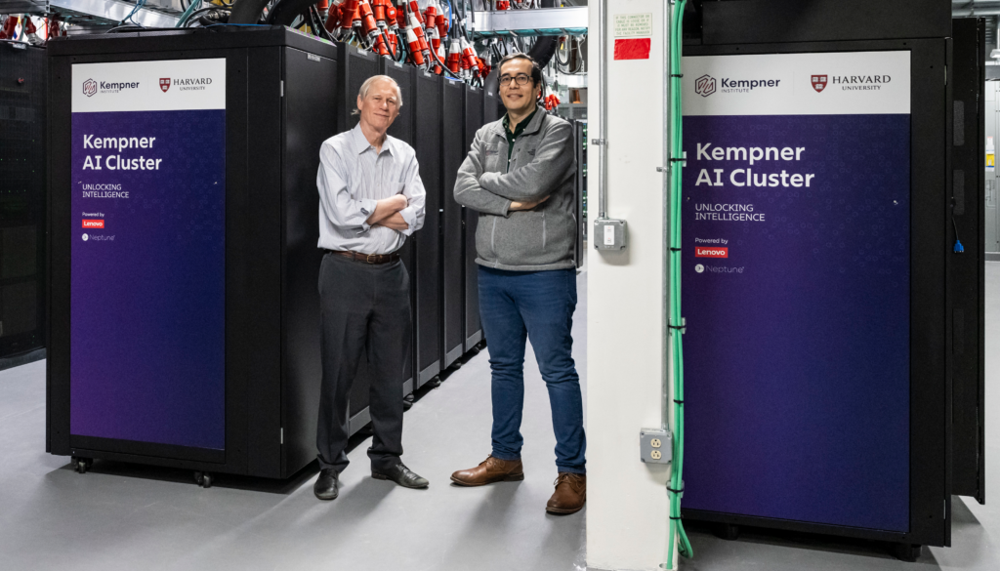

- [Kempner AI Cluster](https://kempnerinstitute.harvard.edu/kempner-ai-cluster/)
---
