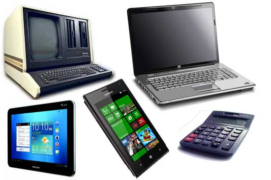
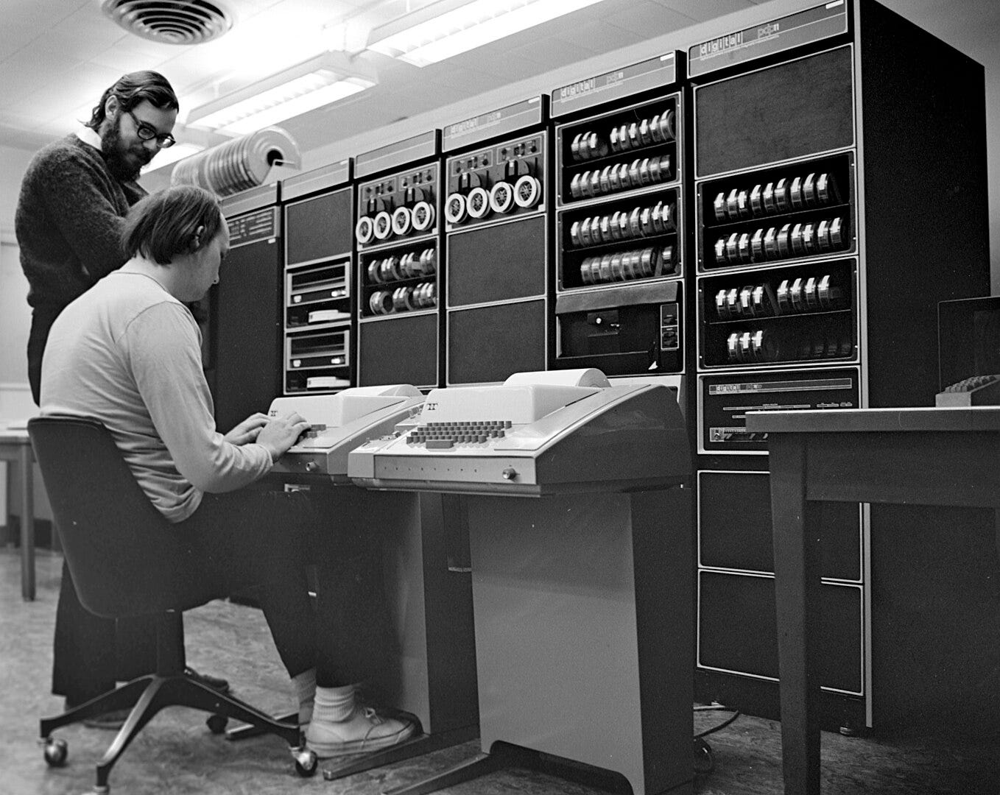
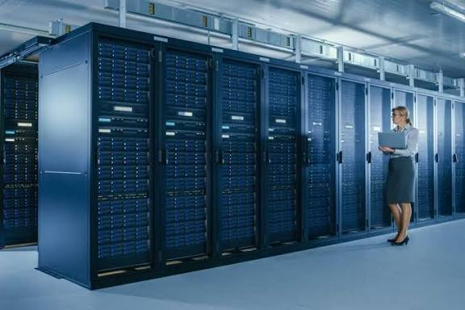

# Types of Computers 

Computers are classified into **four major categories**:

1. **Microcomputers**
2. **Minicomputers**
3. **Mainframe computers**
4. **Supercomputers**

---

## 1. Microcomputers

A **microcomputer** is a small, low-cost digital computer. It usually consists of:

* A **microprocessor**
* A **storage unit**
* An **input channel**
* An **output channel**

These components may be placed on one chip or inserted into one or several **printed circuit boards (PC boards)**.

### Examples of Microcomputers

* IBM PC
* Pentium 100
* IBM PC Pentium 200
* Apple Macintosh

Microcomputers include:

* Desktop computers
* Laptops
* Hand-held computers such as **Personal Digital Assistants (PDAs)**

---

### 1.1 Desktop Computer

A **desktop computer**, also known as a **personal computer (PC)**, is principally intended for **stand-alone use by an individual**.

A typical desktop computer consists of:

* System unit
* Display monitor
* Keyboard
* Internal hard disk storage
* Other peripheral devices

### Major Personal Computer Manufacturers

The course material identifies:

* Apple
* IBM
* Dell
* Hewlett Packard

---

### 1.2 Laptop

A **laptop** is a **portable computer** that a user can carry around.

Laptops are small computers that contain the basic features of a normal desktop computer.

### Advantage of a Laptop

The major advantage is portability. A laptop can be used **anywhere and at any time**, especially while travelling.

---

### 1.3 Hand-Held Computers

A **hand-held computer**, also called a **Personal Digital Assistant (PDA)**, is a computer that can conveniently be stored in a pocket and used while the user is holding it.

PDAs are essentially **small portable computers** and are slightly larger than common calculators.

### Examples of PDAs

* Apple Newton
* Casio Cassiopeia
* Franklin eBookMan

---

# 2. Minicomputers

A **minicomputer** is a small digital computer whose **processing and storage capacity** is:

* Less than that of a **mainframe computer**
* More than that of a **microcomputer**

Its processing speed is between that of a mainframe and a microcomputer.

Minicomputers are generally used as desktop devices and are often connected to a mainframe to perform **auxiliary operations**.

### Characteristics and Uses

Minicomputers are usually **multi-user systems**. They are used in interactive applications in:

* Industries
* Research organisations
* Colleges
* Universities

High-performance workstations with **graphics I/O capability** also use minicomputers.

### Examples of Minicomputers

* PDP II
* IBM 8000 series
* VAX 7500

---

# 3. Mainframe Computers

A **mainframe computer** is an **ultra-high-performance computer** designed for **high-volume, processor-intensive computing**.

It consists of a high-end computer processor and related peripheral devices capable of supporting:

* Large volumes of data processing
* Extensive data storage
* Data retrieval

### Characteristics and Uses

Mainframes are the **second largest** category in the computer family, with **supercomputers** being the largest.

A mainframe allows users to:

* Maintain large amounts of information at a **centralised location**.
* Access data from different computers located in different locations.
* Process centrally stored data.

Mainframe computers are typically used by:

* Large businesses
* Scientific organisations

### Examples of Mainframe Computers

* IBM E5000
* VAX8000
* CDC6600

---

# 4. Supercomputers

**Supercomputers** are special-purpose machines specially designed to maximise the number of **FLOPS (Floating-Point Operations Per Second)**.

According to the course material, a computer below **one gigaflop per second** is not considered a supercomputer.

A supercomputer has the **highest processing speed at a given time** for solving scientific and engineering problems.

### Processing

A supercomputer essentially contains a number of **CPUs that operate in parallel**, making it faster.

The course material gives its processing speed as being in the range of:

> **400–10,000 MFLOPS**
> *(millions of floating-point operations per second)*

### Applications of Supercomputers

Supercomputers are used to solve multivariate mathematical problems involving physical processes such as:

* Aerodynamics
* Meteorology
* Plasma physics

The course material also identifies major commercial use in the:

* Entertainment industry
* Advertising industry

### Examples of Supercomputers

* CRAY-3
* Cyber 205
* PARAM
* [NVIDIA Powers World’s Largest Quantum Research Supercomputer](https://nvidianews.nvidia.com/news/nvidia-powers-worlds-largest-quantum-research-supercomputer)
---

# BASIC COMPUTER ORGANIZATION

The basic organization of a computer system can be represented using a **block diagram** consisting of three major functional units:

1. **Input Unit**
2. **Central Processing Unit (CPU)**
3. **Output Unit**

Each functional unit performs a specific operation in the computer system.

---

# 1. Input Unit

The **Input Unit** is responsible for receiving data, instructions, or commands from the outside world and supplying them to the computer system for processing.

### Functions of the Input Unit

The input unit:

* **Accepts data and instructions** from the outside world.
* **Converts the data** into a form that the computer can understand.
* **Supplies the converted data** to the computer system for further processing.
* Sends information, instructions, or commands to the computer.
* The data received from the input unit is immediately stored in **main memory** and then processed.

### Examples of Input Devices

Some input devices include:

1. **Keyboard**
2. **Mouse**
3. **Light pen**
4. **Joystick**
5. **OCR – Optical Character Recognizer**
6. **MICR – Magnetic Ink Character Recognizer**
7. **OMR – Optical Mark Recognizer**

---

# 2. Central Processing Unit (CPU)

The **Central Processing Unit (CPU)** is responsible for performing calculations, making decisions, interpreting instructions, and controlling the operations of the computer.

### Functions of the CPU

The CPU:

* Performs **calculations and decisions**.
* **Controls and coordinates** all units of the computer.
* **Interprets instructions** of a program.
* **Stores data temporarily**.
* Monitors **external requests**.

## Subsystems of the CPU

The CPU is divided into the following subsystems:

1. **Control Unit (CU)**
2. **Arithmetic and Logical Unit (ALU)**
3. **Memory Unit**

The memory unit is further divided into:

* **Primary Storage**
* **Secondary Storage**

---

# 2.1 Control Unit (CU)

The **Control Unit** instructs the computer on how to carry out program instructions.

It controls and directs the flow of data and instructions between different parts of the computer.

### Functions of the Control Unit

The Control Unit:

* Instructs the computer on how to execute **program instructions**.
* Directs the flow of data between **memory and the Arithmetic and Logical Unit (ALU)**.
* Instructs the input unit where to store data after receiving it from the user.
* Controls the flow of data and instructions from the storage unit to the ALU.
* Fetches instructions from **primary memory** during program execution.
* Decodes the instructions to determine the required operations.
* Sets up the instructions for execution.

### Examples

The Control Unit may coordinate instructions such as:

* Adding two numbers.
* Reading a character from a keyboard.

A number of **registers** are associated with the Control Unit.

### Simple Idea

> **Control Unit = Directs and coordinates computer operations.**

---

# 2.2 Arithmetic and Logical Unit (ALU)

The **Arithmetic and Logical Unit (ALU)** performs all **arithmetic and logical operations** in the computer.

### Arithmetic Operations

Examples include:

* Addition
* Subtraction
* Multiplication

### Logical Operations

Logical operations include **comparisons**.

For example, the ALU can determine whether:

> **A is less than, equal to, or greater than B.**

The ALU performs calculations and makes logical comparisons. After an arithmetic or logical operation has been completed, the result is transferred to the **storage unit**.

### Simple Idea

> **ALU = Performs calculations and comparisons.**

---

# 2.3 Memory Unit

The **Memory Unit** is the part of the computer that holds:

* Data for processing
* Program instructions
* Other information

It is also referred to as **main memory** or **primary memory**.

A memory device stores program instructions or data used by the CPU when performing a particular function.

Memory may be used to store information **temporarily or permanently**.

The course material also notes that **secondary memory**, such as disk storage, is functionally considered I/O because it is accessed through the input/output system.

The memory system is divided into:

1. **Primary Storage**
2. **Secondary Storage**

---

## 2.3.1 Primary Storage

**Primary storage**, also called **main memory**, stores and accesses information very quickly.

It is generally used to hold:

* The program currently being executed.
* Data being received from the input unit.
* Intermediate results of a program.
* Final results of a program.

Primary storage is also known as:

* **System memory**
* **Internal memory**
* **Temporary memory**
* **RAM (Random Access Memory)**

### Characteristics of Primary Storage

* It is installed on the main computer board, or **motherboard**.
* It is typically composed of **integrated circuits (ICs)**.
* It provides **fast access**, usually in the order of **nanoseconds**.

### Simple Idea

> **Primary Storage = Fast memory used while programs are being executed.**

---

## 2.3.2 Secondary Storage

**Secondary storage**, also known as **Auxiliary Storage**, is used to store information such as:

* Programs
* Documents
* Databases

Unlike primary storage, it provides storage for larger amounts of information.

The course material identifies **disk storage** as an example of secondary storage.

---

# 3. Output Unit

The **Output Unit** is the third major functional unit identified in the basic computer organization.

The course material lists the Output Unit as one of the three major units:

> **Input Unit → Central Processing Unit → Output Unit**

**Note:** The supplied pages identify the Output Unit as a major unit but do not provide further detailed description or examples of output devices in the extracted section. Therefore, no additional details have been added here.

---

# The Computing Processing Cycle

The **computing processing cycle** is the continuous sequence of steps followed by the **CPU** to process and complete individual instructions. The cycle consists of four main stages:

> **Fetch → Decode → Execute → Store → Repeat**

The CPU performs these stages repeatedly and at very high speed, allowing a computer to process instructions and produce results efficiently.

## 1. Fetch

The **fetch** stage is the first stage of the processing cycle.

* The CPU retrieves the **next instruction from memory**.
* The **Program Counter (PC)** keeps track of the address of the next instruction.
* After an instruction is fetched, the Program Counter advances to the next instruction.
* The instruction is brought into the CPU so that it can be processed.

**In simple terms:**

> The CPU asks, **“What instruction should I process next?”**

---

## 2. Decode

The **decode** stage is where the CPU interprets the instruction it has fetched.

* The CPU determines **what the instruction means**.
* It identifies the type of operation that needs to be performed.
* The **Control Unit (CU)** helps coordinate this process.
* The instruction is translated into control signals that direct the appropriate parts of the CPU.

**In simple terms:**

> The CPU asks, **“What does this instruction tell me to do?”**

---

## 3. Execute

The **execute** stage is where the CPU carries out the instruction.

The operation may involve:

* Arithmetic calculations
* Logical operations
* Comparing values
* Moving data
* Evaluating conditions

The **Arithmetic and Logic Unit (ALU)** performs arithmetic and logical operations during execution.

**In simple terms:**

> The CPU asks, **“How do I carry out this instruction?”** and performs the required operation.

---

## 4. Store

The **store** stage is where the result of the executed instruction is saved.

The result may be stored in:

* **Registers**
* **RAM**
* Another appropriate destination
* Eventually, secondary storage or an output device when required

The stored result can then be used by the next instruction or made available to the user.

**In simple terms:**

> The CPU asks, **“Where should I save the result?”**

## Example: Calculating a Spreadsheet Total

Suppose a spreadsheet needs to add three numbers.

1. **Fetch** – The CPU retrieves the instruction telling it to read the required cell values.
2. **Decode** – The CPU interprets the instruction as a mathematical operation.
3. **Execute** – The ALU performs the addition.
4. **Store** – The result is placed in a register or memory location and can then be displayed in the spreadsheet.

